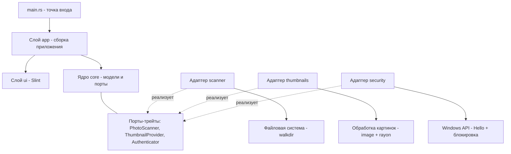

<div align="center">

# 📷 Photo Explorer

**Быстрый и безопасный эксплорер фотографий для Windows 11**

Сканирует ваши папки с фото и показывает их красивой сеткой миниатюр.
Доступ защищён биометрией Windows Hello и PIN-кодом.

[]()
[]()
[]()
[]()
[]()

</div>

---

## 📑 Навигация по документации

| Документ | Что внутри |
|----------|-----------|
| 📐 [Архитектурный план](doc/dev_plans/00_architecture_plan.md) | Стек, модули, Hexagonal-архитектура, диаграммы, паттерны |
| ⚙️ [Установка Rust на Windows](doc/dev_plans/01_rust_setup_windows.md) | Пошаговая настройка окружения для не-разработчика |
| 📋 [Процесс разработки](doc/dev_plans/02_development_process.md) | Правила команды, роли, порядок работы, приёмка этапов |
| 📖 [Учебный журнал](doc/dev_plans/03_dev_journal.md) | Подробный разбор каждого этапа «для человека, не знающего Rust» |
| 🎤 [План презентации (курс AI)](doc/misc/presentation_ai_homework.md) | Учебное задание по проекту (STAR-формат) |

---

## ✨ Возможности (MVP)

- 🗂️ **Два режима сканирования:**
  - только выбранная папка (без подпапок);
  - выбранная папка со всеми подпапками.
  - *(режим «все диски» зарезервирован, пока отключён)*
- 🖼️ **Сетка миниатюр** с кэшем на диске и параллельной генерацией — быстро даже на больших коллекциях.
- 🔍 **Просмотр фото на весь экран** (на активном мониторе): листание колесом и стрелками
  **без задержек и затупа** даже при удержании. Под капотом — один воркер-поток
  (producer-consumer), кэш готовых изображений, предзагрузка соседей и downscale.
  Фокус и клавиши (←/→, Esc) работают сразу. Один слой изображения: миниатюра
  показывается мгновенно, чёткое фото заменяет её той же генерацией — два разных
  кадра одновременно невозможны (без «в фоне один, поверх другой»).
- 🔎 **Зум и pan:** зум к курсору по «ЛКМ + колесо» (с инверсией колеса по просьбе
  заказчика), перетаскивание увеличенного фото «лапкой» (grab-курсор), интерполяция.
  Кламп «край в край» по реальной картинке (contain-fit): увеличенное фото нельзя
  увести за экран — упирается краем в край, как в классических просмотрщиках;
  если картинка по оси меньше экрана — стоит по центру, зум не «прыгает».
- 🔀 **Режимы листания (per-project, панель ⚙):** «До края» — на первом/последнем
  фото стоп (по умолчанию); «Циклично» — заворачивает по кругу; «Случайно» —
  кнопки листания выбирают случайное фото. Настройка сохраняется в проекте.
- 🧹 **Авто-скип битых файлов:** если файл не декодируется (например, `.png` с битой
  сигнатурой), просмотр автоматически переходит к следующему годному фото в текущем
  направлении. Если все битые — показывает плашку «Файл не открывается» вместо
  «залипшего» кадра.
- 🗂 **Проекты и недавние (сессионное хранилище):** папка сканируется ОДИН раз.
  После входа — экран «Проекты» (VS Code Welcome): вкладки Проекты/Недавние,
  карточки с обложками, большая кнопка «＋ Открыть папку как проект». Клик →
  мгновенное открытие из локального хранилища (без пересканирования 8000 файлов);
  миниатюры грузятся порциями в фоне (первые 200 сразу, остальное батчами) —
  окно отзывчиво даже на 10к фото, сетка догружается без фриза;
  фоновая проверка по отпечатку метаданных — если папка изменилась, досканируется
  только разница. Внутри проекта: «← Проекты», имя (клик — переименовать),
  «⚙ Настройки» (режим листания; фон/интерполяция — следующие этапы).
- 🔐 **Защита доступа:** вход по отпечатку пальца (Windows Hello) или PIN-коду.
- 🔒 **Автоблокировка:** при блокировке Windows (Win+L) приложение тоже блокируется.
- 📝 **Логирование** в `./logs/photo_explorer.log` (+ panic hook) — для диагностики.

**Поддерживаемые форматы:** JPG, JPEG, PNG, GIF, BMP, WEBP.

> Планы на будущее: настройки (фон, интерполяция, способ зума), слайдшоу,
> профиль/сессия (запоминание папок и настроек), EXIF-метаданные, поиск и фильтры, шифрование.

---

## 📊 Статус разработки

| Этап | Модуль | Статус |
|------|--------|--------|
| 1 | Фундамент (Cargo + CI) | ✅ Готово |
| 2 | `core` — ядро (модели + порты) | ✅ Готово |
| 2 | `scanner` — сканер папок | ✅ Готово |
| 2 | `thumbnails` — миниатюры | ✅ Готово |
| 2 | `security` — защита доступа | ✅ Готово |
| 3 | `ui` — интерфейс на Slint | ✅ Готово (MVP: блокировка + галерея) |
| 4 | `ui` — просмотр фото: листание (воркер-поток, кэш Image), фуллскрин, фокус, единый слой кадра | ✅ Готово (зум/pan/настройки — в работе) |
| — | `logging` — лог в `./logs/` + panic hook | ✅ Готово |

---

## 🏗️ Архитектура

Проект построен по принципам **SOLID / DRY / KISS** и архитектуре **Hexagonal (Ports & Adapters)**:
ядро приложения не зависит от интерфейса и ОС, поэтому любой слой можно заменить, не трогая бизнес-логику.

Подробности и все диаграммы: [`doc/dev_plans/00_architecture_plan.md`](doc/dev_plans/00_architecture_plan.md).

### Граф архитектуры



**Как читать:** стрелки сверху вниз — зависимости. Ядро (`core`) в центре и ни от кого не зависит.
Адаптеры (`scanner`, `thumbnails`, `security`) реализуют порты-трейты из ядра и общаются с внешним миром
(файлы, картинки, Windows API). UI тоже работает через ядро.

### Структура папок

```
photo_explorer/
├── Cargo.toml              # манифест проекта
├── README.md               # этот файл
├── .gitignore
├── .github/workflows/      # CI (автопроверка кода)
├── doc/                    # вся документация
│   ├── dev_plans/          # планы и учебный журнал
│   └── misc/               # прочее (презентации)
├── src/
│   ├── main.rs             # точка входа
│   ├── lib.rs              # библиотечный корень
│   ├── logging.rs          # логирование в файл + panic hook
│   ├── core/               # ЯДРО: models.rs + ports.rs
│   ├── scanner/            # адаптер сканера
│   ├── thumbnails/         # адаптер миниатюр
│   ├── security/           # адаптер защиты
│   └── ui/                 # интерфейс Slint (блокировка + галерея + viewer)
└── tests/                  # автотесты по одному файлу на модуль
```

---

## 🛠️ Технологии

| Назначение | Технология |
|------------|-----------|
| Язык | [Rust](https://www.rust-lang.org/) 🦀 |
| Интерфейс | [Slint](https://slint.dev/) |
| Изображения | crate `image` |
| Обход файлов | crate `walkdir` |
| Параллелизм | crate `rayon` |
| Обработка ошибок | crate `thiserror` |
| Диалог выбора папки | crate `rfd` |
| Безопасность | crate `windows` (Windows Hello), `argon2` (PIN) |

---

## 🚀 Запуск

### Требования
- **ОС:** Windows 11
- **Rust** (устанавливается через [rustup](https://rustup.rs))
- **Visual Studio Build Tools** (компонент «Desktop development with C++»)
- **Ноутбук/ПК** со сканером отпечатка (для биометрии) — опционально, иначе используется PIN

> Пошаговая установка окружения: [`doc/dev_plans/01_rust_setup_windows.md`](doc/dev_plans/01_rust_setup_windows.md)

### Команды

```powershell
# Собрать и запустить
cargo run

# Собрать релизную (оптимизированную) версию
cargo build --release

# Запустить тесты
cargo test
```

---

## 🧪 Разработка

- Форматирование: `cargo fmt`
- Линтер: `cargo clippy`
- Все изменения проходят автоматическую проверку в CI (GitHub Actions).
- Правила работы команды: [`doc/dev_plans/02_development_process.md`](doc/dev_plans/02_development_process.md).

---

## 📃 Лицензия

Этот проект распространяется по **PolyForm Noncommercial License 1.0.0**.

- ✅ **Некоммерческое использование — бесплатно** (личное, образовательное, исследовательское).
- 💼 **Коммерческое использование — по отдельному лицензионному договору** с автором.

Полный текст: [`LICENSE`](LICENSE). Подробнее о лицензии: <https://polyformproject.org/licenses/noncommercial/1.0.0>.

---

## 📬 Контакты

Автор проекта — связь по вопросам, предложениям и **коммерческой лицензии**:
**dchamel@yandex.ru**

---

<div align="center">
Сделано с 🦀 Rust и ❤️
</div>
