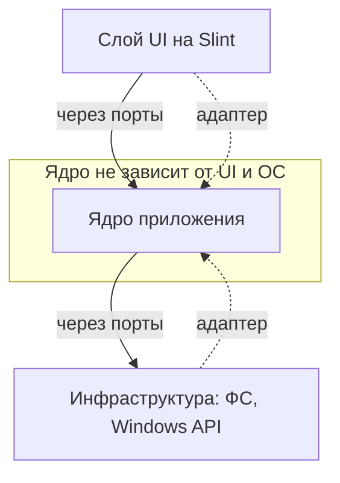
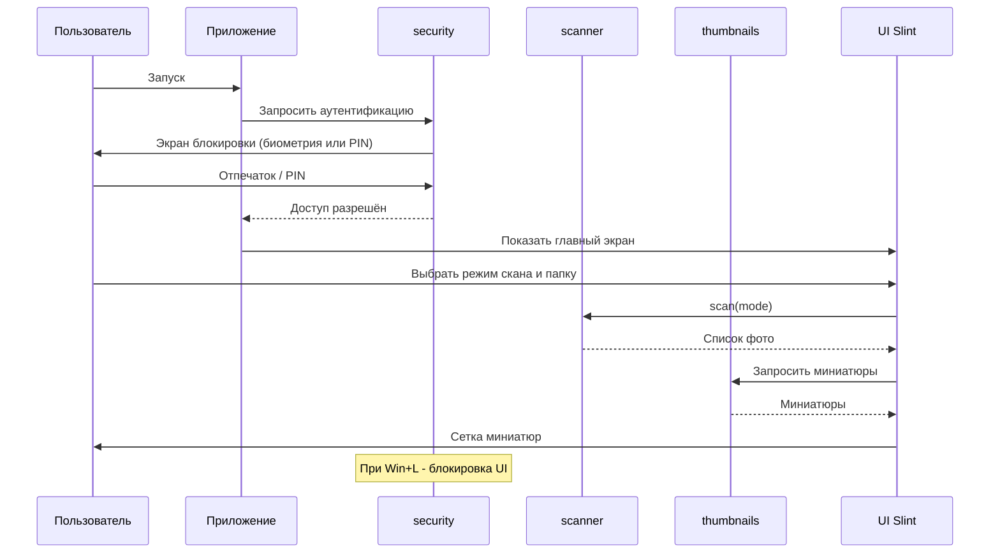

# Архитектурный план проекта «Photo Explorer»

> Главный документ проекта. Здесь фиксируются все архитектурные решения.
> Ведётся архитектором (Джарвис) совместно с заказчиком. Код пишет Солдат (режим Code).

---

## 1. Что это за проект

**Photo Explorer** — десктопное приложение для Windows 11, которое сканирует папки с фотографиями
и показывает их в виде удобной сетки миниатюр с защитой доступа (биометрия Windows Hello + PIN).

Язык: **Rust**. GUI: **Slint**.

---

## 2. Технологический стек и обоснование

| Слой | Технология | Почему именно так |
|------|-----------|-------------------|
| Язык | Rust | Скорость как у C++, безопасность памяти на этапе компиляции |
| Сборка | Cargo | Стандартный менеджер пакетов и сборщик Rust |
| GUI | Slint | Красивый декларативный UI, высокая скорость, читаемый язык разметки |
| Работа с изображениями | crate `image` | Декодирование JPEG/PNG, генерация миниатюр |
| Обход файловой системы | crate `walkdir` | Быстрый рекурсивный обход папок |
| Параллелизм | crate `rayon` | Параллельная генерация миниатюр для скорости |
| Хеш PIN | crate `argon2` | Безопасное хранение PIN-кода |
| Windows API | crate `windows` | Windows Hello и события блокировки сессии |
| Логирование | crate `tracing` | Структурированные логи |
| Ошибки | crate `thiserror` + `anyhow` | Понятная обработка ошибок |

### Почему НЕ выбрали другие варианты
- **egui** — очень быстрый, но «инженерный» вид, не подходит для эстетики фото-галереи.
- **Tauri (веб)** — требует знания двух стеков сразу (Rust + HTML/CSS/JS). Нарушает KISS для первого Rust-проекта.
- **Iced** — хороший кандидат, но у Slint более красивый результат «из коробки» и отдельный язык разметки.

---

## 3. Принципы разработки

- **SOLID** — каждый модуль отвечает за одну задачу, зависимости через абстракции (трейты).
- **DRY** — никакого копипаста, общая логика выносится в переиспользуемые функции.
- **KISS** — простейшее работающее решение. Усложняем только по необходимости.
- **Паттерны** — используем осознанно (см. раздел 6).

---

## 4. Архитектура: Hexagonal (Ports & Adapters)

Главная идея: **ядро приложения (бизнес-логика) не знает о GUI**.
Это защищает нас от болезненной смены UI-фреймворка в будущем.



- **Порт** — это трейт (интерфейс), описывающий ЧТО нужно уметь (например, `ThumbnailProvider`).
- **Адаптер** — конкретная реализация порта (например, генератор миниатюр через crate `image`).
- Выгода: заменить Slint на другой UI = переписать только слой UI, ядро не трогаем.

---

## 5. Структура папок проекта

В корне лежат только самые важные файлы. Всё остальное — по тематическим папкам.

```
photo_explorer/
├── Cargo.toml              # манифест проекта (зависимости, метаданные)
├── README.md               # описание проекта для людей
├── .gitignore
├── .github/
│   └── workflows/
│       └── ci.yml          # пайплайн CI/CD (GitHub Actions)
├── doc/                    # вся документация
│   └── dev_plans/          # планы разработки
│       ├── 00_architecture_plan.md   # этот файл
│       └── 01_rust_setup_windows.md  # как установить Rust
├── src/
│   ├── main.rs             # ТОЧКА ВХОДА (главный запускник)
│   ├── app/                # сборка приложения, связывание ядра и UI
│   │   └── mod.rs
│   ├── core/               # ЯДРО (бизнес-логика, не знает об UI/ОС)
│   │   ├── mod.rs
│   │   ├── ports.rs        # трейты-порты (абстракции)
│   │   └── models.rs       # доменные модели (Photo, ScanMode и т.д.)
│   ├── scanner/            # модуль сканирования папок
│   │   └── mod.rs
│   ├── thumbnails/         # модуль генерации и кэша миниатюр
│   │   └── mod.rs
│   ├── security/           # модуль защиты (Windows Hello, PIN, блокировка)
│   │   └── mod.rs
│   └── ui/                 # слой интерфейса на Slint
│       ├── mod.rs
│       └── views/          # .slint файлы разметки экранов
│           ├── lock.slint      # экран блокировки
│           └── gallery.slint    # главный экран галереи
├── ui/                     # (альтернативно) .slint ресурсы, если удобнее
└── tests/                  # АВТОТЕСТЫ, по одному файлу на модуль
    ├── scanner_tests.rs
    ├── thumbnails_tests.rs
    └── security_tests.rs
```

> Примечание: точное размещение `.slint`-файлов уточним на этапе UI.

---

## 6. Модули MVP и их ответственность

### 6.1. `scanner` — сканирование папок
Три режима работы (требование заказчика):

| Режим | Что делает |
|-------|-----------|
| `AllDrives` | Скан всех папок (по доступным дискам) |
| `SingleFolder` | Скан только конкретной папки (без подпапок) |
| `FolderRecursive` | Скан конкретной папки и всех её подпапок |

Порт: `trait PhotoScanner { fn scan(&self, mode: ScanMode) -> Result<Vec<PhotoRef>>; }`

### 6.2. `thumbnails` — миниатюры
- Генерация миниатюр фиксированного размера из исходных фото.
- Кэш на диске (чтобы не пересчитывать каждый раз).
- Параллельная обработка через `rayon`.

Порт: `trait ThumbnailProvider { fn thumbnail(&self, photo: &PhotoRef) -> Result<ThumbData>; }`

### 6.3. `security` — защита доступа
- **Биометрия:** Windows Hello через `UserConsentVerifier` (ОС подтверждает владельца, сам отпечаток приложению недоступен — это правильно и безопасно).
- **PIN:** 4 цифры, хранятся как **хеш Argon2** (никогда в открытом виде). PIN — резервный способ к биометрии.
- **Автоблокировка:** подписка на системное событие `WTS_SESSION_LOCK`. Когда Windows блокируется (Win+L) — приложение тоже блокирует свой UI.

Порты: `trait Authenticator`, `trait SessionLockWatcher`.

> **Уровень защиты (согласовано с заказчиком):** защита рассчитана на «случайного человека рядом с ноутбуком» —
> именно это и требуется. Это блокировка UI приложения, а не военный уровень.
> Файлы на диске остаются доступны через проводник. Полное шифрование хранилища — в бэклоге (не MVP).

---

## 7. Диаграмма сценария запуска (MVP)



---

## 8. Используемые паттерны проектирования

| Паттерн | Где применяем | Зачем |
|---------|---------------|-------|
| Ports & Adapters (Hexagonal) | вся архитектура | Изоляция ядра от UI и ОС |
| Strategy | режимы скана `ScanMode` | Разное поведение скана без ветвлений в коде |
| Repository | доступ к кэшу миниатюр | Абстракция над хранилищем |
| Facade | слой `app` | Простой вход для UI в сложное ядро |
| Dependency Injection | связывание в `app` | Подмена реализаций (в т.ч. в тестах) |

---

## 9. Тестирование

- Каждый модуль покрывается автотестами в отдельном файле папки `tests/`.
- Юнит-тесты (внутри модуля через `#[cfg(test)]`) — для внутренней логики.
- Интеграционные тесты (`tests/*.rs`) — проверяют модуль целиком через его публичный API.
- Благодаря портам-трейтам легко подставлять «заглушки» (mock) вместо реальной ФС и Windows API.

---

## 10. Этапы разработки (дорожная карта)

- **Этап 0 — Документация.** Этот план, инструкция по Rust, README.
- **Этап 1 — Старт кода.** Инициализация Cargo-проекта (`Cargo.toml` + заглушка `src/main.rs`), первый коммит и пуш.
  - *Опционально:* лёгкая автопроверка на GitHub (`.github/workflows/ci.yml`): `cargo fmt` + `clippy` + `test`.
    Это НЕ полноценный CI/CD с деплоем (нам он не нужен — приложение десктопное, не серверное),
    а просто автопроверка качества кода при пуше. Включается по желанию.
- **Этап 2 — Ядро.** Модули scanner, thumbnails, security + их тесты.
- **Этап 3 — UI.** Экран блокировки и галерея на Slint, интеграция с ядром.

---

## 11. Бэклог (после MVP)

- Просмотр фото в полном размере.
- Чтение EXIF-метаданных (дата, камера, геолокация).
- Поиск и фильтры.
- Шифрование хранилища.
- Поддержка других ОС (сейчас фокус только на Windows 11).

---

*Документ живой: обновляется по мере принятия новых решений.*
