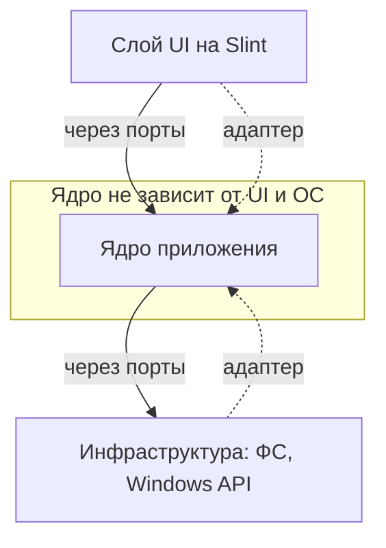
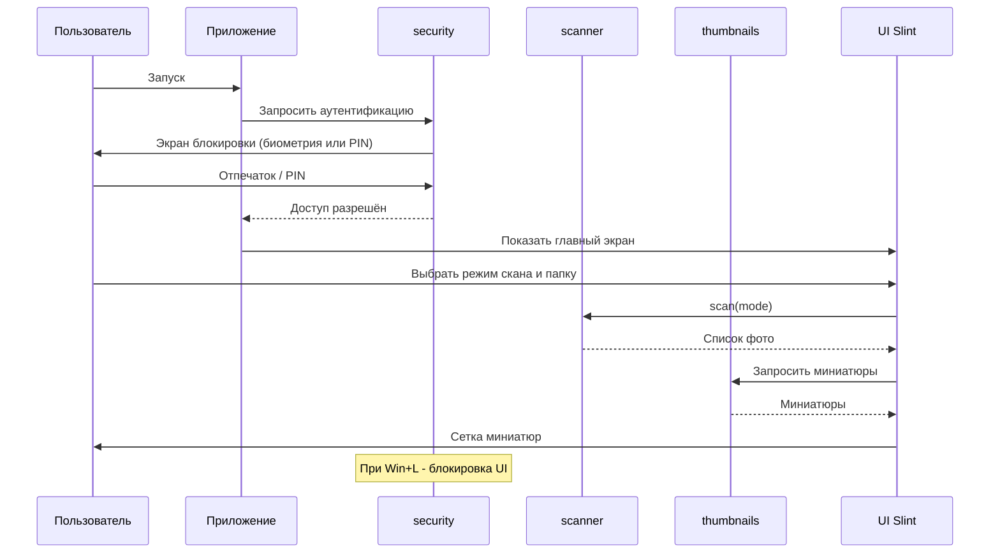

# Архитектурный план проекта «Photo Explorer»

> Главный документ проекта. Здесь фиксируются все архитектурные решения.
> Ведётся архитектором (Джарвис) совместно с заказчиком. Код пишет Солдат (режим Code).

---

## 1. Что это за проект

**Photo Explorer** — десктопное приложение для Windows 11, которое сканирует папки с фотографиями
и показывает их в виде удобной сетки миниатюр с защитой доступа (биометрия Windows Hello + PIN).

Язык: **Rust**. GUI: **Slint**.

---

## 2. Технологический стек и обоснование

| Слой | Технология | Почему именно так |
|------|-----------|-------------------|
| Язык | Rust | Скорость как у C++, безопасность памяти на этапе компиляции |
| Сборка | Cargo | Стандартный менеджер пакетов и сборщик Rust |
| GUI | Slint | Красивый декларативный UI, высокая скорость, читаемый язык разметки |
| Работа с изображениями | crate `image` | Декодирование JPEG/PNG, генерация миниатюр |
| Обход файловой системы | crate `walkdir` | Быстрый рекурсивный обход папок |
| Параллелизм | crate `rayon` | Параллельная генерация миниатюр для скорости |
| Хеш PIN | crate `argon2` | Безопасное хранение PIN-кода |
| Windows API | crate `windows` | Windows Hello и события блокировки сессии |
| Логирование | crate `tracing` | Структурированные логи |
| Ошибки | crate `thiserror` + `anyhow` | Понятная обработка ошибок |

### Почему НЕ выбрали другие варианты
- **egui** — очень быстрый, но «инженерный» вид, не подходит для эстетики фото-галереи.
- **Tauri (веб)** — требует знания двух стеков сразу (Rust + HTML/CSS/JS). Нарушает KISS для первого Rust-проекта.
- **Iced** — хороший кандидат, но у Slint более красивый результат «из коробки» и отдельный язык разметки.

---

## 3. Принципы разработки

- **SOLID** — каждый модуль отвечает за одну задачу, зависимости через абстракции (трейты).
- **DRY** — никакого копипаста, общая логика выносится в переиспользуемые функции.
- **KISS** — простейшее работающее решение. Усложняем только по необходимости.
- **Паттерны** — используем осознанно (см. раздел 6).

---

## 4. Архитектура: Hexagonal (Ports & Adapters)

Главная идея: **ядро приложения (бизнес-логика) не знает о GUI**.
Это защищает нас от болезненной смены UI-фреймворка в будущем.



- **Порт** — это трейт (интерфейс), описывающий ЧТО нужно уметь (например, `ThumbnailProvider`).
- **Адаптер** — конкретная реализация порта (например, генератор миниатюр через crate `image`).
- Выгода: заменить Slint на другой UI = переписать только слой UI, ядро не трогаем.

---

## 5. Структура папок проекта

В корне лежат только самые важные файлы. Всё остальное — по тематическим папкам.

```
photo_explorer/
├── Cargo.toml              # манифест проекта (зависимости, метаданные)
├── README.md               # описание проекта для людей
├── .gitignore
├── .github/
│   └── workflows/
│       └── ci.yml          # пайплайн CI/CD (GitHub Actions)
├── doc/                    # вся документация
│   └── dev_plans/          # планы разработки
│       ├── 00_architecture_plan.md   # этот файл
│       └── 01_rust_setup_windows.md  # как установить Rust
├── src/
│   ├── main.rs             # ТОЧКА ВХОДА (главный запускник)
│   ├── app/                # сборка приложения, связывание ядра и UI
│   │   └── mod.rs
│   ├── core/               # ЯДРО (бизнес-логика, не знает об UI/ОС)
│   │   ├── mod.rs
│   │   ├── ports.rs        # трейты-порты (абстракции)
│   │   └── models.rs       # доменные модели (Photo, ScanMode и т.д.)
│   ├── scanner/            # модуль сканирования папок
│   │   └── mod.rs
│   ├── thumbnails/         # модуль генерации и кэша миниатюр
│   │   └── mod.rs
│   ├── security/           # модуль защиты (Windows Hello, PIN, блокировка)
│   │   └── mod.rs
│   └── ui/                 # слой интерфейса на Slint
│       ├── mod.rs
│       └── views/          # .slint файлы разметки экранов
│           ├── lock.slint      # экран блокировки
│           └── gallery.slint    # главный экран галереи
├── ui/                     # (альтернативно) .slint ресурсы, если удобнее
└── tests/                  # АВТОТЕСТЫ, по одному файлу на модуль
    ├── scanner_tests.rs
    ├── thumbnails_tests.rs
    └── security_tests.rs
```

> Примечание: точное размещение `.slint`-файлов уточним на этапе UI.

---

## 6. Модули MVP и их ответственность

### 6.1. `scanner` — сканирование папок
Три режима работы (требование заказчика):

| Режим | Что делает | Статус |
|-------|-----------|--------|
| `AllDrives` | Скан всех папок (по доступным дискам) | ОТКЛЮЧЁН (закомментирован, задел на будущее) |
| `SingleFolder` | Скан только конкретной папки (без подпапок) | Активен |
| `FolderRecursive` | Скан конкретной папки и всех её подпапок | Активен |

> Решение заказчика: режим `AllDrives` временно отключён (медленный, пока не нужен — KISS).
> Код сохранён под комментарием, чтобы включить позже. Рабочие режимы: `SingleFolder` и `FolderRecursive`.

**Поддерживаемые форматы (MVP, согласовано с заказчиком):**
`jpg`, `jpeg`, `png`, `gif`, `bmp`, `webp` (сравнение расширений без учёта регистра).

Порт: `trait PhotoScanner { fn scan(&self, mode: ScanMode) -> Result<Vec<PhotoRef>>; }`

Доменная модель `Photo` (минимум для MVP): абсолютный путь к файлу, имя файла,
размер в байтах. Расширяемость (EXIF, дата съёмки) — в бэклоге.

### 6.2. `thumbnails` — миниатюры
- Генерация миниатюр фиксированного размера из исходных фото.
- Кэш на диске (чтобы не пересчитывать каждый раз).
- Параллельная обработка через `rayon`.

Порт: `trait ThumbnailProvider { fn thumbnail(&self, photo: &PhotoRef) -> Result<ThumbData>; }`

### 6.3. `security` — защита доступа
- **Биометрия:** Windows Hello через `UserConsentVerifier` (ОС подтверждает владельца, сам отпечаток приложению недоступен — это правильно и безопасно).
- **PIN:** 4 цифры, хранятся как **хеш Argon2** (никогда в открытом виде). PIN — резервный способ к биометрии.
- **Автоблокировка:** подписка на системное событие `WTS_SESSION_LOCK`. Когда Windows блокируется (Win+L) — приложение тоже блокирует свой UI.

Порты: `trait Authenticator`, `trait SessionLockWatcher`.

> **Уровень защиты (согласовано с заказчиком):** защита рассчитана на «случайного человека рядом с ноутбуком» —
> именно это и требуется. Это блокировка UI приложения, а не военный уровень.
> Файлы на диске остаются доступны через проводник. Полное шифрование хранилища — в бэклоге (не MVP).

---

## 7. Диаграмма сценария запуска (MVP)



---

## 7.1. UX/UI дизайн-гайд (Этап 3)

**Тема:** тёмная (согласовано с заказчиком). Фото на тёмном фоне смотрятся выигрышнее.

### Палитра
| Роль | Цвет | HEX |
|------|------|-----|
| Фон основной | тёмно-серый | `#1E1E1E` |
| Фон панелей | чуть светлее | `#2A2A2A` |
| Текст основной | почти белый | `#F0F0F0` |
| Текст вторичный | серый | `#9A9A9A` |
| Акцент (кнопки, фокус) | синий | `#3B82F6` |
| Ошибка | красный | `#EF4444` |

### Экран блокировки (`lock.slint`) — UX v3 (по отзыву заказчика)
- Центрированная карточка на тёмном фоне, иконка-замок 🔒 + заголовок «Photo Explorer».
- **Точки-индикаторы PIN на основном окне** (4 точки, заполняются по мере ввода).
- **Встроенная клавиатура:** кнопка «Войти по PIN» разворачивает цифровую клавиатуру (1–9, 0, ⌫)
  **прямо в этом же окне** (окно раздвигается вниз), НЕ в отдельном окне.
- **Автовход:** как только введены 4 корректные цифры — вход происходит автоматически (без кнопки «ОК»).
- **PIN задаётся один раз** при первом запуске; сброс — удалением файла PIN. Валидация: ровно 4 цифры.
- При неверном PIN — красное сообщение, точки очищаются.

### Биометрия — ПРАВИЛЬНАЯ логика (исправление зависания)
**Корень зависания (v3):** `op.get()` в `windows_hello.rs` синхронно **блокирует UI-поток**
на всё время, пока открыт системный диалог Hello. UI «не отвечает», клики не обрабатываются,
а повторный запрос даёт дедлок (два синхронных ожидания WinRT в одном потоке).

**Правильное решение (паттерн «блокирующая операция в фоне → результат в UI»):**
- Блокирующий вызов `op.get()` выполняется в **отдельном потоке** (`std::thread::spawn`),
  чтобы НЕ морозить UI-поток.
- Результат возвращается в UI-поток через **`slint::invoke_from_event_loop`** — только там
  можно трогать окно (скрыть при успехе, показать ошибку при отказе).
- **Флаг «проверка идёт»** (`AtomicBool` / `Mutex<bool>`): пока биометрия выполняется,
  повторные запросы (клик по кнопке, повторный автозапрос) игнорируются — защита от дедлока.
- Автозапрос один раз при старте (если PIN задан и биометрия доступна).
- Кнопка «Отпечаток пальца» — ручной повтор (тоже уважает флаг).

> Прошлая гипотеза «фоновый поток ломает Hello» была неверной. Реальная причина — блокировка
> UI-потока синхронным `op.get()`. Фоновый поток для `op.get()` + возврат результата через
> `invoke_from_event_loop` — это и есть правильный паттерн.

### Активация окна Hello — финальное решение (биометрия по клику пользователя)
**Проблема:** `SetForegroundWindow` из фона Windows блокирует (защита от «кражи» фокуса).
Автозапрос биометрии при старте всплывает в фоне — не работает.

**Правило Windows:** приложение может вывести окно на передний план ТОЛЬКО в ответ на
действие пользователя (клик/клавиша) — «input-driven foreground».

**Финальное решение (подсказано заказчиком):**
- **Автозапрос биометрии при старте УБРАН** (он не работал из-за ограничения фокуса).
- Открывается наш экран с кнопками «👆 Войти по отпечатку» и «Войти по PIN».
- Биометрия запускается ТОЛЬКО по клику пользователя по кнопке. В этот момент наше окно
  уже активно (пользователь по нему кликнул), поэтому системный запрос Hello всплывает
  поверх активным — палец прикладывается сразу, без клика по чужому окну.

Формула входа: «Запустил → Кликнул Отпечаток → Приложил → Зашёл». Это не костыль, а
корректное следование правилам Windows про фокус (так делают многие приложения).

**Попытка усилить фокус (v7):** если по клику Hello всё равно сзади — применяем трюк
`AttachThreadInput` (временно подключаем ввод нашего потока к потоку активного окна,
тогда `SetForegroundWindow` проходит) + `SetActiveWindow`/`SetFocus` + небольшая задержка.
> **Решение архитектора:** если `AttachThreadInput` не поможет — ПРИНИМАЕМ как ограничение ОС
> (один клик по системному окну) и НЕ бьёмся дальше. Фокус системного окна — зона Windows,
> 100% гарантии нет. Не застреваем на этом.

### Дополнения к экрану блокировки (v7)
- **Кнопка «Назад» (←)** в свободной ячейке клавиатуры: прячет клавиатуру, возвращает на
  главный экран блокировки (если передумал вводить PIN). Сбрасывает введённые цифры.
- **Лимит попыток PIN:** 3 неверных ввода подряд → приложение закрывается (защита от подбора).
  Счётчик сбрасывается при успешном входе.

> **Почему системное окно Windows Hello нельзя убрать:** отпечаток хранится в защищённом модуле (TPM),
> приложению недоступен — ОС возвращает только «владелец: да/нет» (стандарт безопасности, как у Apple/Android).
> Мы вызываем биометрию из UI-потока и поднимаем окно на передний план; гарантировать перехват фокуса
> системным окном на 100% ОС не позволяет, но правильный вызов из UI-потока обычно это решает.

### Главный экран / галерея (`gallery.slint`)
- Верхняя панель: название + кнопки выбора режима скана:
  «Выбрать папку» и «Папка с подпапками».
- Основная область: адаптивная **сетка миниатюр** (wrap, прокрутка).
- Под каждой миниатюрой — имя файла (вторичный текст, обрезается).
- Пустое состояние: подсказка «Выберите папку, чтобы увидеть фото».
- Индикатор загрузки во время скана/генерации миниатюр.

### Принципы юзабилити
- Фокус по умолчанию на поле PIN (можно сразу печатать).
- Enter в поле PIN = нажатие «Войти».
- Крупные кликабельные зоны, понятные подписи на русском.
- Отзывчивость: тяжёлые операции (скан/миниатюры) не морозят интерфейс.

---

## 7.2. Фаза «Красота / UX» (после MVP)

Разбита на управляемые под-этапы, каждый — со СТОП на ручное тестирование.

### 4.1. Сетка миниатюр
- Адаптивная сетка (4–6 карточек в ряд, перенос по ширине окна, прокрутка).
- Карточки: квадратные превью, скругление, подсветка/тень при наведении (hover).
- Имя файла под превью (обрезка длинных).

### 4.2. Просмотр фото (viewer) — базовый + производительность ✅ ПРИНЯТО
- Клик по миниатюре → полноэкранный просмотр фото.
- **Автоподстройка по ширине экрана** (image-fit).
- Листание: стрелки ←/→ и клавиши. Esc — закрыть.
- **Фокус сразу при открытии** (FocusScope.focus()) — чтобы клавиши/Esc работали без доп. клика.
- **Полноэкранный режим** (set_fullscreen) только при открытии фото, на текущем мониторе;
  при закрытии — возврат в обычное окно (как в играх: приложение в окне, просмотр на весь экран).

#### Производительность viewer (критично — «архи-супер-быстро»)
- **Кэш полных изображений в памяти** (LRU, последние N штук) — повторное открытие мгновенно.
- **Предзагрузка соседей**: пока смотрим текущее фото, в фоне грузятся следующее и предыдущее →
  листание без задержки.
- **Downscale при декодировании**: не держать 20 Мп, если экран меньше — уменьшать до размера экрана.
- Загрузка всегда в фоновом потоке; UI не блокируется.
- **Отмена устаревших загрузок** через «поколение» (AtomicU64): при листании старые результаты
  отбрасываются — нет мигания чужими фото и лавины потоков.

> **Что было исправлено после первых тестов (4.2b):**
> - *Краш* при листании — из-за отравленного (poisoned) Mutex и лавины потоков. Введён
>   `lock_or_recover` (не паникуем на отравленном мьютексе) и `catch_unwind` на декодировании.
> - *Зависание «Не отвечает»* — **deadlock** на нереентерабельном Mutex: guard кэша жил до конца
>   `if let`, а внутри вызывался preload_neighbors, бравший тот же Mutex. Фикс: guard освобождается
>   сразу после клонирования. Подробно — в журнале, раздел 4.2b.
> - Добавлена **система логирования** (`src/logging.rs`): лог в `%TEMP%/photo_explorer/photo_explorer.log`
>   + panic hook. По логу видно, что и почему произошло.

### 4.3. Просмотр фото — листание, зум и перемещение (механика согласована с заказчиком)
**Листание (основное) ✅ ПРИНЯТО (v8):**
- **Колесо мыши** (без зажатой ЛКМ) — листает фото (следующее/предыдущее).
- Стрелки ←/→ (клавиатура и экранные) — листают.
- **Удержание стрелки** → быстрое «моргание» фоток (мгновенная миниатюра-плейсхолдер,
  чёткое догружается). Без затупа даже при долгом удержании.

> **Как добились плавности (эпопея v1→v8, подробно — в журнале, раздел 4.3):**
> - **Один воркер-поток** (producer-consumer, `mpsc`-канал) вместо `std::thread::spawn`
>   на каждую задачу — убрало лавину из сотен ОС-потоков при удержании.
> - **Дренирование очереди**: воркер берёт только последнюю актуальную задачу.
> - **Два кэша**: сырой RGBA (`Arc<Mutex>`, для воркера) + готовые `slint::Image`
>   (`Rc<RefCell>`, UI-поток). КЛЮЧ к плавности: показ из кэша = дешёвый `clone` готового
>   `Image`, БЕЗ попиксельного копирования RGBA (до 26 МБ) на каждый кадр — это и был
>   главный источник затупа, найденный по логу.
> - **Поколение (`AtomicU64`)** — устаревшие результаты отбрасываются.
> - Индикатор «Загрузка» убран (избыточен при мгновенном показе).
>
> **Главный урок:** не гадать, а измерять — лог сразу указал на истинную причину.
> См. также: логи приложения теперь в `./logs/` (на время разработки, в `.gitignore`).

**Зум (доп. функция):**
- Способ зума **настраивается** (см. 4.4) — два варианта на выбор пользователя:
  - **«ЛКМ + колесо»** (по умолчанию, как просил заказчик): пока ЛКМ зажата, колесо зумит,
    а не листает; отпустил ЛКМ — колесо снова листает.
  - **«Колесо»** (классический вариант): колесо напрямую зумит к точке под курсором,
    а листание — только стрелками.
- **Интерполяция** при зуме, чтобы не было «квадратиков» — но с возможностью **отключить**
  (настройка, см. 4.4): кому-то нужны чёткие пиксели без сглаживания.

**Pan («лапка»):**
- Отпустил ЛКМ после зума → курсор-«лапка».
- Снова зажал ЛКМ (без колеса) → «хватаю» картинку и перетаскиваю (pan) для осмотра деталей.

**Закрытие:** только `Esc` и кнопка ✕. Клик ЛКМ по фото больше **не** закрывает просмотр
(ЛКМ занята зумом/pan) — по просьбе заказчика.

- Технически: ручная работа с масштабом (zoom) и смещением (offset) изображения в Slint.
  Самая сложная UI-часть — возможны итерации.

### 4.4. Настройки и слайдшоу
**Секция настроек (новое, по просьбе заказчика):**
- **Фон просмотра** (общий для одиночного просмотра и слайдшоу): чёрный / выбранный цвет /
  фоновое фото. Иногда нужен чисто чёрный фон.
- **Режим интерполяции** при зуме: вкл/выкл (сглаживание или чёткие пиксели).
- **Способ зума**: «ЛКМ + колесо» (по умолчанию) или «колесо» (напрямую) — на выбор пользователя.
- **Запоминание** между запусками (файл настроек, как хранение PIN).

**Слайдшоу:**
- Кнопка «Слайдшоу» в верхней панели → окно настроек:
  интервал (сек), порядок (по имени / случайно), зацикливание.
- **Запоминание настроек** между запусками.
- Запуск → автопоказ фото по интервалу (использует общий фон из настроек).

### 4.5. Мелочи и общий лоск
- Экран блокировки: анимация точек PIN, плавное появление клавиатуры.
- Иконка приложения (окно + .exe).
- Единая типографика (размеры/отступы), плавные переходы между экранами.

### 4.6. Профиль / состояние (по просьбе заказчика)
Смысл PIN — не только защита, но и персональная сессия. Сейчас после каждого входа
приходится заново открывать папки — это неудобно. Нужно **запоминать профиль**:
- Последние открытые папки / пути (чтобы при входе сразу показать их, а не пустой экран).
- Настройки (фон, интерполяция, способ зума, задержка листания, параметры слайдшоу).
- Возможно — «базу» просканированного (список фото), чтобы не сканировать заново.
- Хранение: файл профиля (как PIN-хэш). При входе — восстанавливаем состояние.
- На будущее: профиль можно привязать к PIN (у разных PIN — разные профили).

> **Оценка архитектора:** 4.3 (зум+pan) — технически самый сложный пункт (ручные трансформации
> в Slint). Если упрёмся — сделаем базовый зум без pan и вернёмся позже. Остальное — средней сложности.
>
> **Разбивка 4.3 на под-шаги (чтобы тестировать по кусочкам):**
> - 4.3a — убрать закрытие по ЛКМ (освободить ЛКМ под зум/pan), листание колесом.
> - 4.3b — зум по «ЛКМ + колесо» с интерполяцией.
> - 4.3c — pan «лапкой».
> - 4.3d — быстрое «моргание» при удержании стрелки.
> - 4.3e — авто-скип битых файлов (Invalid PNG signature и т.п.): при ошибке декода
>   автоматически переходим к следующему годному фото в текущем направлении; защита
>   от зацикливания через `skip_depth`; если все битые — плашка «Файл не открывается».
> - 4.3f — фикс «прыжка» при зуме: зум и pan конфликтовали за offset (pan шёл от
>   замороженного старта) → инкрементальный pan (`viewer-pan-by`); кламп offset
>   «край в край» (`clamp_offset`: max = (vp·zoom − vp)/2) — фото всегда закрывает
>   экран, упираясь краем в край, как в классических просмотрщиках.
> - 4.3g — фикс скипа «через один» (двойное +dir: воркер шлёт index+dir, обработчик
>   прибавлял dir ещё раз) + кламп по КАРТИНКЕ (contain-fit): contain_scale =
>   min(vp_w/iw, vp_h/ih), размер на экране = img·scale·zoom — узкие/широкие фото
>   больше нельзя утащить за экран; prev-mouse при любом нажатии ЛКМ.
> - 4.3h — скип сверяет поколение (generation): устаревший авто-скип битого файла
>   больше не накладывает свой кадр поверх актуального при быстром листании.
> - 4.3i — РАДИКАЛЬНЫЙ фикс рассинхрона «в фоне один кадр, поверх второй»:
>   убран двойной слой (viewer-thumbnail + viewer-image) — слой ОДИН, миниатюра
>   пишется мгновенно в viewer-image, чёткое фото перезаписывает его той же
>   генерацией (одно поколение на переход, единый метод switch_to_photo на
>   контексте ViewerCtx). Два разных кадра одновременно невозможны по построению.
> - 4.4a — режимы листания per-project (⚙): edge «до края» (стоп на границе,
>   по умолчанию — чинит «прыжок в конец» при prev на первом фото) | cycle
>   «циклично» (заворот) | random «случайно» (обе кнопки — случайный кадр).
>   NavMode + FromStr + чистая nav_next(cur, count, dir, mode) → Option<i32>;
>   Session.nav_mode (serde(default), переживает перескан и перезапуск).
>   Заодно: фоновая загрузка миниатюр сессии (один фоновый поток: миниатюры →
>   save → fingerprint-проверка) — чинит фриз UI на 10-60 сек при открытии
>   проекта с 8-10к фото.
> - 4.4b — порционная загрузка галереи (батчи миниатюр): первый батч 200
>   оживляет сетку сразу, остальное добавляется батчами по 150 в фоне до
>   полной модели (viewer-моргание сохраняется; gallery_gen отменяет батчи
>   старого проекта). Чинит «тупит 30-60 сек» на 10k фото даже из тёплого
>   кэша: 10k PNG декодировались + 10k карточек строились одним куском.
>   Единый путь load_thumbs_batched для скана/открытия/досскана (DRY).
> - 4.4c — random через ПЕРЕМЕШАННЫЙ список (идея заказчика): при включении
>   строим shuffle-перестановку индексов (биекция) ОДИН раз; next/prev ходят
>   по позициям списка → «назад» честно возвращает просмотренное (раньше
>   gen_range на каждый тик «пердолил» новыми кадрами без истории).
>   shuffled_order + nav_random_next (чистые, протестированы); ViewerCtx:
>   shuffle_order/shuffle_pos, set_nav строит/сбрасывает. Тот же список —
>   фундамент слайд-шоу (автопоказ = next по порядку поверх таймера).
> - 4.4c-2 — авто-скип битых в random идёт ПО перемешанному списку
>   (nav_random_next от shuffle_pos в направлении dir; раньше скип линейно
>   убегал 1531→1532→1533 — кадр «сам сменялся», shuffle_pos рассинхронился).
>   Открытие кликом в random синхронизирует shuffle_pos с открытым фото.
> - 4.4 — настройки (фон + интерполяция) выносим отдельным шагом перед/после 4.3 по согласованию.
>
> **4.7 — Проекты и недавнее (сессионное хранилище).** Цель: сканировать папку
> ОДИН раз, при повторном входе открывать мгновенно, не пересканируя 8000 файлов.
> ГЛАВНОЕ требование заказчика: открытие сессии должно быть БЫСТРЫМ — не медленнее
> (а много быстрее) нового скана; смысла в хранилище, равном по скорости скану, нет.
>
> - **UX:** после входа по биометрии/PIN — экран «Старт»: слева «Проекты» (именованные
>   пользователем, как внутренние проекты), справа «Недавние» (recent, автоматически,
>   даже если пользователь не сохранял). Клик по записи → мгновенное открытие.
> - **Хранилище:** один JSON на сессию — `sessions/<id>.json` (id, имя, путь, режим
>   скана flat/recursive, fingerprint, список `Photo` с метаданными, время открытия,
>   флаг проект/recent). Плюс лёгкий `index.json` — только список сессий (id, имя,
>   путь, время) БЕЗ списков файлов, чтобы стартовый экран рисовался мгновенно.
>   SQLite не берём (KISS: один проект = один файл, читается в килобайтах).
> - **Fingerprint папки** — по МЕТАДАННЫМ без чтения тел файлов: `(относительный путь,
>   размер, mtime)` по каждому файлу, затем быстрый хеш отсортированного списка.
>   Совпал → папка не менялась, берём кэш. Обход метаданных 8000 записей — секунды
>   против минут полного скана с генерацией миниатюр.
> - **Быстрое открытие:** (1) читаем `<id>.json` → мгновенно список `Photo`;
>   (2) показываем галерею сразу из кэша миниатюр на диске (с прошлого раза);
>   (3) ФОНОМ считаем fingerprint — совпал: ничего; изменился: инкрементальный
>   досскан ТОЛЬКО разницы (новые/удалённые) + миниатюры новых. Показ не блокируется.
> - **Порт `SessionStore`** (Hexagonal) — ядро не зависит от формата хранилища.
> - Доступ к истории — после входа по биометрии/PIN (ради чего вход и задумывался).
> - В бэклог: полная контрольная сумма содержимого (точнее, но дорого) — как опция.

---

## 8. Используемые паттерны проектирования

| Паттерн | Где применяем | Зачем |
|---------|---------------|-------|
| Ports & Adapters (Hexagonal) | вся архитектура | Изоляция ядра от UI и ОС |
| Strategy | режимы скана `ScanMode` | Разное поведение скана без ветвлений в коде |
| Repository | доступ к кэшу миниатюр | Абстракция над хранилищем |
| Facade | слой `app` | Простой вход для UI в сложное ядро |
| Dependency Injection | связывание в `app` | Подмена реализаций (в т.ч. в тестах) |

---

## 9. Тестирование

- Каждый модуль покрывается автотестами в отдельном файле папки `tests/`.
- Юнит-тесты (внутри модуля через `#[cfg(test)]`) — для внутренней логики.
- Интеграционные тесты (`tests/*.rs`) — проверяют модуль целиком через его публичный API.
- Благодаря портам-трейтам легко подставлять «заглушки» (mock) вместо реальной ФС и Windows API.

---

## 10. Этапы разработки (дорожная карта)

- **Этап 0 — Документация.** Этот план, инструкция по Rust, README.
- **Этап 1 — Старт кода.** Инициализация Cargo-проекта (`Cargo.toml` + заглушка `src/main.rs`), первый коммит и пуш.
  - *Опционально:* лёгкая автопроверка на GitHub (`.github/workflows/ci.yml`): `cargo fmt` + `clippy` + `test`.
    Это НЕ полноценный CI/CD с деплоем (нам он не нужен — приложение десктопное, не серверное),
    а просто автопроверка качества кода при пуше. Включается по желанию.
- **Этап 2 — Ядро.** Модули scanner, thumbnails, security + их тесты.
- **Этап 3 — UI.** Экран блокировки и галерея на Slint, интеграция с ядром.

---

## 11. Бэклог (после MVP)

- Просмотр фото в полном размере.
- Чтение EXIF-метаданных (дата, камера, геолокация).
- Поиск и фильтры.
- **Поддержка форматов RAW** (CR2, NEF, ARW, DNG — фото с камер).
- **Поддержка формата HEIC** (снимки с iPhone и современных камер).
- Шифрование хранилища.
- Поддержка других ОС (сейчас фокус только на Windows 11).

---

*Документ живой: обновляется по мере принятия новых решений.*
