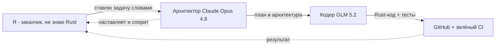

# План презентации: «Архитектор и Солдат: как я собрал Rust-приложение, не зная Rust»

> Домашнее задание курса по AI. Формат STAR, 3-5 слайдов, ~3 минуты эфира.
> Тема: применение ИИ для разработки десктопного приложения Photo Explorer.

---

## 🎯 Ёмкое название (варианты на выбор)

1. **«Архитектор и Солдат: как я собрал Rust-приложение, не зная Rust»** ← рекомендую
2. «ИИ-команда из двух моделей: я ставлю задачи — они пишут код»
3. «От идеи до рабочего кода на незнакомом языке за один вечер»

> Рекомендую №1: интригует метафорой ролей и сразу показывает «вау-эффект» (не знаю язык, но получил результат).

---

## 🗂️ Структура: 4 слайда по методу STAR

### Слайд 1 — Situation (Ситуация) + Название
**Заголовок:** Архитектор и Солдат: как я собрал Rust-приложение, не зная Rust

**Текст (тезисы для устной речи):**
- Я хотел сделать десктопное приложение — эксплорер фотографий с защитой по отпечатку пальца.
- Проблема: приложение нужно на языке **Rust** (быстрый и безопасный), а я его **не знаю**.
- Обычный путь — месяцы обучения. Я решил пойти другим путём: собрать **команду из ИИ-моделей**.

**Визуал:** иконка 📷 + большой знак вопроса над «Rust 🦀».

---

### Слайд 2 — Task (Задача)
**Заголовок:** Что требовалось сделать

**Текст:**
- Спроектировать **архитектуру** приложения по инженерным принципам (SOLID, DRY, KISS).
- Написать работающий **код на Rust** с модульной структурой и автотестами.
- Настроить профессиональный процесс: документация, git, автопроверка кода (CI).
- Всё это — **без личного знания Rust**, выступая в роли заказчика и постановщика задач.

**Визуал:** чеклист из 4 пунктов с галочками.

---

### Слайд 3 — Action (Действия) — ГЛАВНЫЙ слайд
**Заголовок:** Как я организовал ИИ-команду из двух ролей

**Ключевая идея — две ИИ-модели с разными ролями:**

| Роль | Модель | Что делает |
|------|--------|-----------|
| 🏗️ **Архитектор** («Джарвис») | Claude Opus 4.8 | Проектирует архитектуру, ведёт документацию, спорит со мной, если решение вредное |
| 💻 **Кодер** («Солдат») | GLM 5.2 | Пишет Rust-код по утверждённой архитектуре, прогоняет тесты |

**Мои действия как постановщика:**
- Описал словами, что хочу → Архитектор задал уточняющие вопросы и **отговорил меня** от переусложнения (хотел CI/CD как для сайта — он объяснил, что для десктопа это лишнее).
- Вместе выбрали стек: Rust + Slint (GUI) + Hexagonal-архитектура.
- Архитектор составил пошаговый план и инструкцию по установке — провёл меня как наставник.
- Кодер по плану создал проект, настроил автопроверку на GitHub, сделал коммит.

**Визуал:** схема «Я (заказчик) → Архитектор → Солдат → GitHub». Можно взять Mermaid-диаграмму ниже.

---

### Слайд 4 — Result (Результат)
**Заголовок:** Что получилось

**Текст:**
- ✅ Рабочий Rust-проект, который **собирается и запускается** (скрин консоли — у тебя уже есть).
- ✅ Профессиональная структура: модули, документация, автотесты, **зелёный CI на GitHub**.
- ✅ Полный архитектурный план на русском — понятный мне, не-программисту.
- 📈 **Главный вывод:** ИИ сместил мою роль с «кодера» на «архитектора задачи». Я управляю результатом, не зная синтаксиса языка.

**Визуал:** скриншот `cargo run` + зелёная галочка GitHub Actions.

**Финальная фраза для эфира:**
> «Я не выучил Rust. Я научился ставить задачи так, чтобы ИИ сделал это за меня — и качественно.»

---

## 📊 Диаграмма для слайда 3 (можно вставить картинкой)

---

## 🎤 Тайминг на 3 минуты

| Слайд | Время | Фокус речи |
|-------|-------|-----------|
| 1. Situation | ~30 сек | «Хотел приложение, но не знаю язык» |
| 2. Task | ~30 сек | Что именно требовалось |
| 3. Action | ~90 сек | Главное: две ИИ-роли, как я ими управлял |
| 4. Result | ~30 сек | Скрин + вывод + финальная фраза |

---

## 💡 Советы по подаче

- Делай акцент на **нестандартности подхода**: не «ИИ написал код», а «я собрал из ИИ инженерную команду с ролями».
- Упомяни, что Архитектор **возражал** тебе — это показывает, что ИИ не слепой исполнитель, а партнёр.
- Скрин запуска консоли покажи именно на слайде Result — как доказательство.
- Говори простым языком, аудитория оценит честность «я не шарю в Rust, и это сработало».
